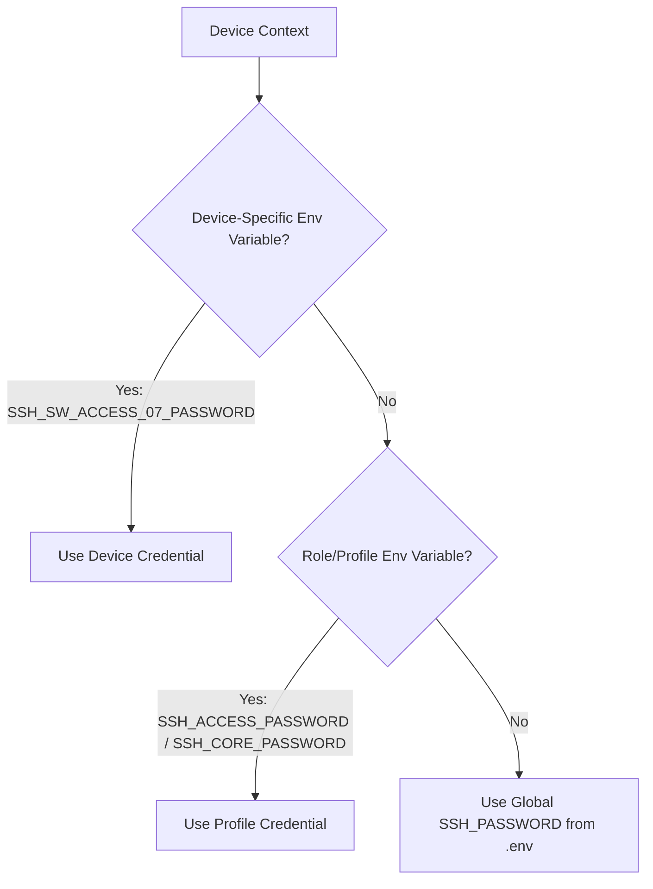

# Security & Environment Configuration Architecture

> [!IMPORTANT]
> **Production Security Standard**: This repository is configured for Zero-Trust secret storage. No API tokens, passwords, private keys, or SSH credentials are hardcoded in source files or committed to Git. All runtime credentials are strictly injected via local environment variables (`.env`).

---

## 1. Why Secrets Must Not Be Hardcoded in GitHub

Hardcoding credentials (API tokens, SSH passwords, enable secrets) directly in source code creates severe security risks when pushing repositories to GitHub:
- **Public / Team Exposure**: Hardcoded secrets are visible to anyone with repository access.
- **Permanent Git History**: Committing a secret stores it permanently in git commit history, even if deleted in a later commit.
- **Production Vulnerability**: Compromised NetBox API tokens allow unauthorized REST API mutations or data exfiltration across enterprise network infrastructure.

---

## 2. Summary of Security & Environment Modifications

The table below details the exact files modified during the pre-GitHub security hardening process:

| File Path | Modifications Made | Security Rationale |
| :--- | :--- | :--- |
| **`config/settings.py`** | Added environment loading logic (`os.getenv("NETBOX_TOKEN", "")` and `os.getenv("NETBOX_URL", "http://localhost:8000")`). Removed hardcoded token string. | Ensures legacy CSV importer modules pull tokens dynamically from the environment without storing hardcoded secrets. |
| **`deployment/config.py`** | Updated `NETBOX_TOKEN = os.getenv("NETBOX_TOKEN", "")`. Set `SSH_PASSWORD` and `SSH_SECRET` defaults to empty strings `""` instead of `"admin"`. | Eliminates fallback token secrets and prevents silent SSH login attempts using default passwords when environment variables are missing. |
| **`python/importers/common_api.py`** | Updated `DummySettings` fallback class to read `os.getenv("NETBOX_TOKEN", "")` instead of a hardcoded dummy hex token. | Cleans up hardcoded dummy token strings in fallback handlers. |
| **`.env.example`** | Replaced device-specific credentials (`SSH_SW_ACCESS_07_PASSWORD`) with safe placeholder strings (`your_device_password_here`). | Guarantees `.env.example` can be safely committed to GitHub as a public template without revealing actual lab credentials. |
| **`.gitignore`** | Fixed typo on line 1 (`i__pycache__/` ➔ `__pycache__/`). Confirmed `.env` is ignored while keeping `artifacts/` tracked. | Ensures compiled Python binaries and sensitive `.env` credential files are strictly excluded from version control. |

---

## 3. Environment Variable Architecture (`.env` vs `.env.example`)

To maintain clean environment separation across development, testing, and production deployments:

```
enterprise_real_sot/
├── .env.example    <-- Committed to GitHub (Contains variable names & safe placeholders ONLY)
└── .env            <-- Local file ONLY (Git-ignored, contains REAL local secrets)
```

1. **`.env.example` (Tracked in Git)**:
   - Serves as the official configuration contract for the repository.
   - Contains variable keys and descriptive placeholders (e.g., `NETBOX_TOKEN=your_netbox_token_here`).
2. **`.env` (Strictly Git-Ignored)**:
   - Created locally by copying `.env.example`: `cp .env.example .env`.
   - Populated with live NetBox tokens and switch SSH credentials.
   - Never committed or pushed to remote repositories.

---

## 4. Credential Resolution Hierarchy

Credentials are automatically loaded at runtime through `deployment/config.py` and resolved by `deployment/credentials.py` (`CredentialResolver`):



### Supported Variable Scopes:

- **NetBox REST API Authorization**:
  - `NETBOX_URL`: Base NetBox URL (e.g. `http://localhost:8000/api/`).
  - `NETBOX_TOKEN`: Bearer API token injected into `Authorization: Token <NETBOX_TOKEN>` headers.
- **Global Default SSH Credentials**:
  - `SSH_USERNAME`, `SSH_PASSWORD`, `SSH_SECRET`.
- **Profile-Specific Credentials (by Device Role)**:
  - `SSH_ACCESS_USERNAME`, `SSH_ACCESS_PASSWORD`, `SSH_ACCESS_SECRET` (Access Switches).
  - `SSH_CORE_USERNAME`, `SSH_CORE_PASSWORD`, `SSH_CORE_SECRET` (Core Switches).
- **Device-Specific Override Credentials**:
  - `SSH_<DEVICE_NAME>_USERNAME`, `SSH_<DEVICE_NAME>_PASSWORD` (e.g., `SSH_SW_ACCESS_07_PASSWORD`).

---

## 5. Sanitization Notice

The following hardcoded values were identified during audit and purged from the source code:
- **NetBox Development API Token**: Removed from `config/settings.py` and `deployment/config.py`.
- **Default SSH Credentials**: Hardcoded fallback values (`"admin"`) were removed from `deployment/config.py`.
- **Dummy Hex Tokens**: Removed from `python/importers/common_api.py`.
- **Lab Switch Passwords**: Purged from `.env.example`.

---

## 6. Pre-Commit Verification Commands

Before pushing repository updates, verify that no hardcoded credentials exist and that sensitive environment files are excluded:

### 1. Repository-Wide Secret Scan
```bash
grep -RniE 'NETBOX_TOKEN|SSH_PASSWORD|nbt_' config/ deployment/ python/ device_migration/ pre_deployment_validation/ post_deployment_validation/
```
*Expected Output*: Only `os.getenv(...)` references should appear (zero hardcoded token strings).

### 2. Verify Git Ignore Rules
```bash
git status --ignored
```
*Expected Output*: `.env` must appear under `Ignored files:`.

### 3. Validate Python Syntax & Config Loading
```bash
python3 -m py_compile config/settings.py deployment/config.py python/importers/common_api.py
python3 -c "import config.settings as s; from deployment import config as c; print('Config loaded successfully')"
```

---

## 7. Required Security Action (Token Rotation)

> [!WARNING]
> **Token Revocation Requirement**:
> Because the development NetBox API token was previously present in commit history, it must be treated as **compromised**.
> 
> **Immediate Action Required**:
> 1. Open the NetBox UI at `http://localhost:8000/user/api-tokens/`.
> 2. Revoke and delete the old API token.
> 3. Generate a new API token with appropriate read/write scope.
> 4. Update the new token in your local `.env` file (`NETBOX_TOKEN=<new_token>`).
